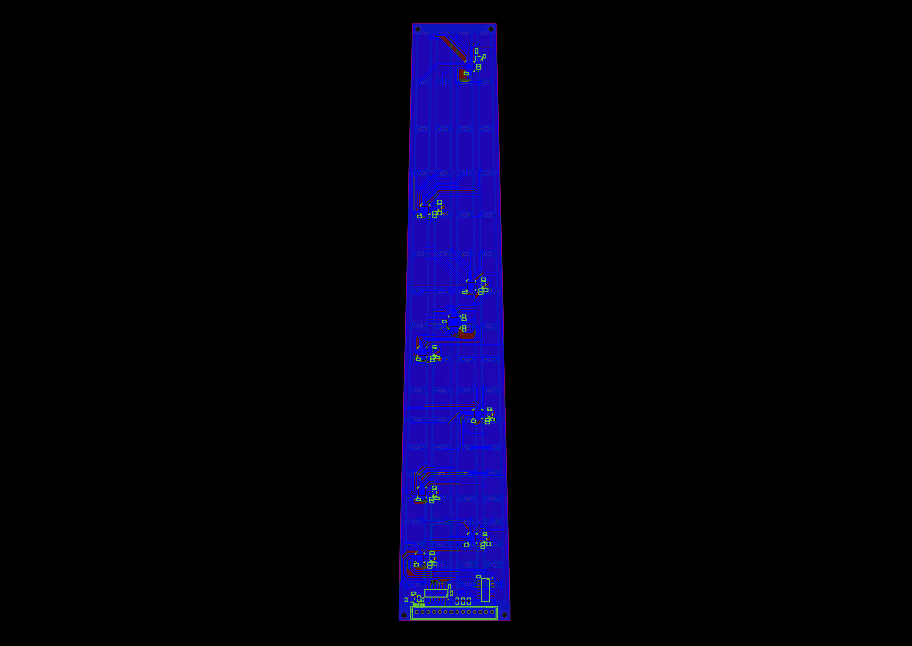

# 新版电路板资料

可编辑源文件为 [ProPrj_Uke_2026-11-21.epro2](JLCEDA/ProPrj_Uke_2026-11-21.epro2)。使用嘉立创EDA专业版导入，源文件记录的编辑器版本为3.2.149.88089769。包含6套板级设计、6张原理图页及PCB，并嵌入符号／封装／器件库。

| 模块 | 原理图预览 | PCB预览 |
|---|---|---|
| 主板 | [查看](Previews/主板_原理图.webp) | [查看](Previews/主板_PCB.webp) |
| 电源板 | [查看](Previews/电源板_原理图.webp) | [查看](Previews/电源板_PCB.webp) |
| 功放板 | [查看](Previews/功放板_原理图.webp) | [查看](Previews/功放板_PCB.webp) |
| 光电管发射端 | [查看](Previews/光电管发射端_原理图.webp) | [查看](Previews/光电管发射端_PCB.webp) |
| 光电管接收端 | [查看](Previews/光电管接收端_原理图.webp) | [查看](Previews/光电管接收端_PCB.webp) |
| 电容品格 | [查看](Previews/电容品格_原理图.webp) | [查看](Previews/电容品格_PCB.webp) |

预览直接提取自本次epro2内嵌图像，便于浏览。制造时应在原工程检查网络、层叠、封装及器件属性，再正式导出Gerber、BOM和贴片坐标；没有将缩略图当作制造文件。

[BOM-derived.csv](BOM-derived.csv)从原理图属性提取418条位号记录，可能包含空属性或非贴装项，仅作索引。缺少的值以可编辑工程中的器件／库属性为准。

项目中主控开发板为Tang Primer 25K，ESP32承担通信管理；电容品格板包括触摸和灯阵。具体引脚以当前原理图及FPGA的CST、ESP32源文件交叉核对。

自有设计的许可见根目录LICENSES/README.md，库元件及第三方参考模型保留原有归属。
