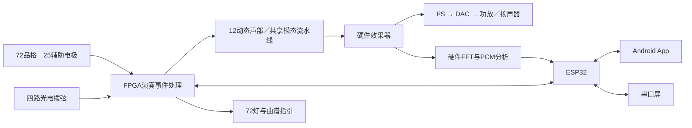

# 电子尤克里里 · FPGA实时模态合成

一把由 **Tang Primer 25K / 高云 GW5A-LV25MG121NC1/I0** 实时计算声音的电子尤克里里。

这里公开新版整机的 **FPGA RTL、ESP32固件、Android App、串口屏工程、六块电路板设计、SolidWorks整机装配与零件**，以及对应编译产物和验证记录。

**[观看／下载整机展示视频](https://github.com/nick335618/ukulele-open-source/releases/download/open-source-2026-11-21/Ukulele_Demo.mp4)** · **[安装 Android App](https://github.com/nick335618/ukulele-open-source/releases/download/open-source-2026-11-21/UkuleleStudio-v3.19.12-debug.apk)** · **[全部发布文件](https://github.com/nick335618/ukulele-open-source/releases/tag/open-source-2026-11-21)**

## 这把琴如何工作

左手的电容品格确定音高，右手的四路光电检测决定拨弦时机。FPGA直接完成选音、事件处理、动态声部分配、模态递推、音效与I²S输出。ESP32负责通信、曲谱调度和状态同步，App与串口屏提供操作和练习入口。

### 已有能力

- 12个动态声部，每声部最多60个弦模态，基础琴体模型8模态；音色切换保留相应历史状态。
- 50 MHz主时钟、每1024拍一个音频样本，采样率48,828.125 Hz。
- 尤克里里物理建模、吉他风格合成、拇指琴和光晕钟四种音色配置，支持包络参数设置。
- 一拍锁定／四弦复音，同弦最高品位选择，滑音、两种颤音判定和模拟变调夹。
- 震音、合唱、弗兰格与电吉他失真，支持效果组合及作用范围控制。
- 72灯独立配置、亮度与呼吸效果、App灯效编辑和AI辅助生成。
- 曲谱倍速指引、多音与空弦指引、同音重复提示、渐亮渐灭、乐器自动播放。
- App曲库、MIDI移调与指法分配、PDF／照片显示与识谱校对、试听、全屏跟弹、评分和演奏录奏。
- FPGA 4096点FFT、原始PCM波形与延迟音频XY显示；数据经ESP32传输到App／屏幕。
- 屏幕与App同步休眠唤醒，新电源板的电量和充电状态读取、光电发射端管理。

## 从哪里开始

| 想做什么 | 入口 |
|---|---|
| 先看效果 | [整机展示视频](https://github.com/nick335618/ukulele-open-source/releases/download/open-source-2026-11-21/Ukulele_Demo.mp4) |
| 下载安装包及固件 | [Releases](https://github.com/nick335618/ukulele-open-source/releases/tag/open-source-2026-11-21)、[Firmware](Firmware) |
| 阅读／编译RTL | [FPGA/Project/modal60/gv_host.gprj](FPGA/Project/modal60/gv_host.gprj) |
| 阅读ESP32程序 | [ESP32/esp32_ukulele](ESP32/esp32_ukulele) |
| 修改Android App | [Android_App](Android_App) |
| 修改串口屏 | [Screen](Screen) |
| 打开嘉立创PCB工程 | [最新版epro2工程](Hardware/Electrical/JLCEDA/ProPrj_Uke_2026-11-21.epro2) |
| 查看原理图／PCB缩略图与物料索引 | [电路板导航](Hardware/Electrical/README.md) |
| 下载3D装配和打印相关零件 | [机械设计导航](Hardware/Mechanical/README.md)、[原始3D包](https://github.com/nick335618/ukulele-open-source/releases/download/open-source-2026-11-21/Uke-V2.rar) |
| 购买FPGA／ESP32开发板、电池和扬声器 | [用户指定的采购链接](Docs/Procurement.md) |
| 从源码复现 | [编译与烧录](Docs/BUILDING.md) |
| 确认版本、已知问题和验证边界 | [发布说明](Docs/RELEASE_NOTES.md)、[验证导航](Verification/README.md) |

## 当前快照

本次开源整理日期为 **2026年11月21日**。源程序采用最近配套交付的 **App 3.19.12／versionCode 90、FPGA 8D36**，ESP32与之配套；PCB和3D采用本次提供的新文件。

对应FPGA完整布局布线报告：Logic 22,103/23,040，CLS 11,432/11,520，BSRAM 56/56，DSP 28/28；50 MHz约束下Setup/Hold违例均为0，Fmax 50.020 MHz。最差Setup裕量0.008 ns，内部时序余量较紧。SDC当前主要约束主时钟，板级外设I/O时序约束尚未完整补齐。

历史App配套回归为80项通过。公开快照不分发个人导入的《成都》MIDI，该用例在缺少文件时跳过；其余回归可按[验证说明](Verification/README.md)运行。原始ROM、位流、ESP32固件和APK保留对应版本，不把整理发布描述为新一次实物测试。

颤音在不同品位的触发一致性仍需校准；电量格数来自电压估计，充电状态依赖硬件信号有效；识谱需要校对。请先阅读[已知问题](Docs/RELEASE_NOTES.md)。

## 开源许可

项目自有软件／RTL使用 **MIT**，自有电路与机械设计使用 **CERN-OHL-P-2.0**，自有说明文档使用 **CC-BY-4.0**。第三方库、模型、器件模型、曲谱和引用材料遵循各自原有许可，不被这些默认许可覆盖。

详见 [LICENSE](LICENSE)、[许可范围](LICENSES/README.md) 和 [第三方说明](Third_Party_Notices/README.md)。

联网AI需自行配置个人API通道。本仓库不提供开发者密钥、个人账户数据或签名私钥。所有下载文件的完整性可用 [SHA256SUMS.txt](SHA256SUMS.txt) 核对。
